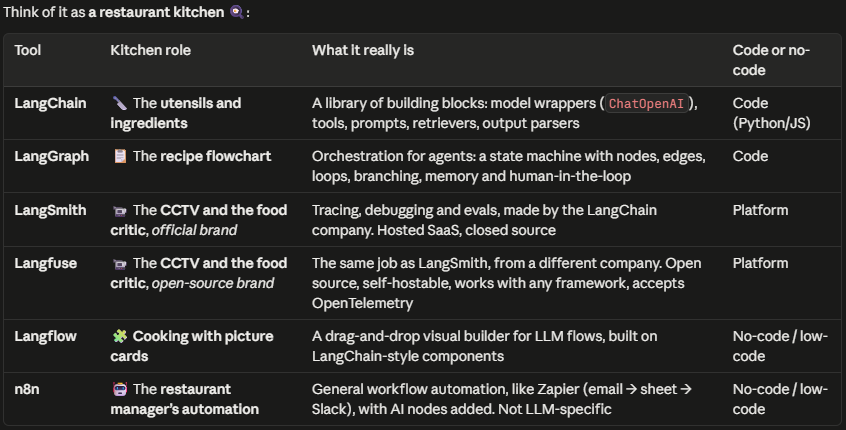

1. Why use an agent here instead of a fixed set of diagnostic SQL checks? When would the fixed checks win?
2. What does MCP give you over writing the tools directly in your code? What does it cost?
3. How does your loop stop, and what happens when it hits the step budget?
4. What exactly is in a span, and how would you find the most expensive step across 1,000 runs?
5. How did you grade the answers, and how do you know your LLM judge is right? Compare it with your own labels on 20 cases.
6. How would a malicious row in the data attack your agent, and what stops it?
7. What would you change to run this in production on Snowflake? Think about auth, cost limits, caching, and alerting on failed investigations. This one links back to your existing production LLM monitoring story.

EUROPE is at 0.51, which we planted, but ASIA is at 0.70 with no incident at all. Normal week-to-week noise is around ±30%. So the agent can’t just say “down 50%, so it’s a bug”. It has to compare against normal variation and run the health checks.

8. What does MCP give you compared with calling duckdb.connect() directly?
“MCP decouples the agent from its tools (the agent doesn’t need to know how DuckDB works; it just asks a middleman). With duckdb.connect(), I’d hard-code the database client, write my own tool schemas and permission checks, and redo all of it for every new data source. With MCP, the server advertises its tools at runtime via tools/list, with JSON schemas the LLM can read (it hands the model a menu with instructions for each dish). So adding Snowflake or GitHub later is a config change, not a code change (plug in a new middleman, and the agent stays the same).
It also gives me a security boundary (the dangerous stuff lives behind a door I control). The server runs read-only, caps rows and characters, and labels tools with hints like readOnlyHint. So even if the model hallucinates a DELETE or gets prompt-injected, the guardrail is enforced in the server, not in the prompt (a polite ‘please don’t delete’ in the prompt can be ignored; a locked door can’t). And because it’s a standard protocol, the same server works with any MCP host: Claude Desktop, Cursor, or LangGraph agent (write once, plug in anywhere).”
Short version, if they want one line: “MCP turns tools into plug-and-play, self-describing services with a permission boundary, so the agent isn’t hard-wired to the database.”

Who’s who (the 3 MCP roles):
---------------------------------------------------------------------------------------------------------------------------
Role	What it is	In your project
---------------------------------------------------------------------------------------------------------------------------
Host	The app the user runs. It owns the LLM, decides which servers to connect to, and enforces user permissions	
        Right now mcp_hello.py (with no LLM yet). From M3, your agent app. Claude Desktop and Cursor are examples of hosts
---------------------------------------------------------------------------------------------------------------------------
Client	The connector inside the host. There’s one client per server, and it speaks the protocol	
        The ClientSession object in your script
---------------------------------------------------------------------------------------------------------------------------
Server	Exposes tools, resources and prompts, and does the real work	
        The mcp-server-motherduck process, which holds the DuckDB connection
---------------------------------------------------------------------------------------------------------------------------

# uv run .\src\data_incident_investigator_agent\agent_loop.py
Red Flags for Model= 'gpt-4.1-mini' and thin prompt:
1. 2 of 6 turns were wasted guessing the schema. At scale, that’s cost and latency for nothing.
2. The evidence is thin. “No rows for today” is just the symptom restated. It never compared against a baseline (about 60 orders a day before), and it never checked whether sales actually happened. Here’s the killer clue it missed: the lineitem rows for today’s orders still exist. You only deleted from orders. Line items pointing at missing orders prove the sales happened and the orders load failed.
3. “Confidence: High” is unjustified. It says “sales did not stop”, but nothing it ran proves that.

